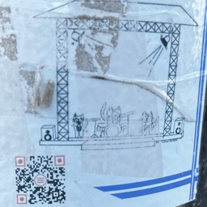

# qrcode.worlds
No context QR codes found in the street. Scan at your own risk.

    
    
    

    
    
    

    
    
    

    
    
    

    
    
    

    
    
    

    
    
    

    
    
    

    
    

